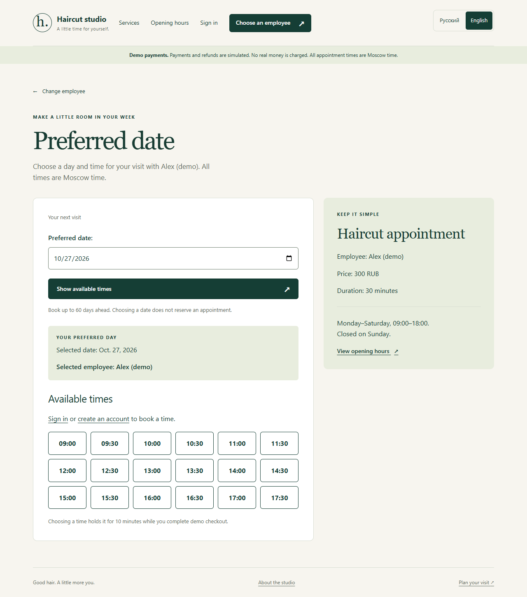
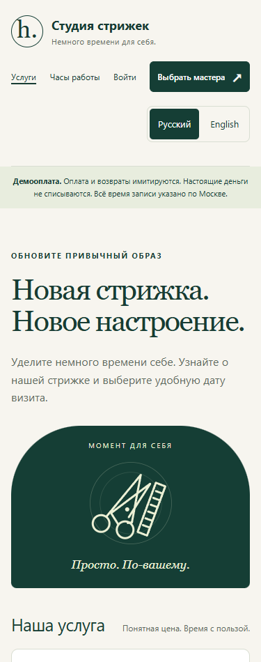

# Haircut Studio — appointment booking

[Русский](README.md) · **English**

A Django and PostgreSQL portfolio project that takes a salon visit from employee
selection through temporary reservation, demo payment, receipt and cancellation.
The focus is reliable booking behavior: simultaneous requests, expiring holds,
repeat submissions and clear refund rules.

**Python 3.14 · Django 5.2 · PostgreSQL 18 · Django templates · Russian / English**


## What you can review

- **Customer flow:** verified email accounts, password recovery, employee-specific
  availability, ten-minute holds, booking history and full eligible demo refunds.
- **Booking reliability:** transactions and employee-row locks prevent overlapping
  reservations through supported write paths. Request/event keys make retries safe.
- **Administration:** employees, time off, cancellations, protected CSV export and
  required authenticator sign-in for staff.
- **Interface:** responsive HTML/CSS, keyboard controls, a live hold countdown and
  Russian/English selection with a remembered browser preference.
- **Telegram staff bot:** private allowlisted schedules, booking cards, daily
  statistics and a durable notification queue with bounded retries. Optional;
  requires your BotFather token and approved Telegram IDs.
- **Verification:** PostgreSQL tests exercise concurrency, ownership, CSRF,
  payment retries, refund boundaries, MFA access and language behavior.

Payments are simulated. Email is saved locally by default. Public hosting, real
SMTP delivery and live payment processing have not been configured. This is a
guided learning project with AI-assisted implementation; the demo and tests show
what the application currently does.

## Start the prepared local project

From the project directory in Ubuntu/WSL:

```bash
bash scripts/run.sh
```

The script reads the private `.env`, uses the existing `.venv` and starts the
local development server. It installs nothing. Leave its terminal open and use
**Ctrl+C** to stop it.

Open [the website](http://127.0.0.1:8000/services/) or
[About the studio](http://127.0.0.1:8000/about/).

**New checkout:** follow [Setup](docs/SETUP.md) for prerequisites, dependencies,
PostgreSQL, private settings and sample data. The application deliberately uses
PostgreSQL for local work and tests so booking-lock behavior matches the tested
database.

## Five-minute demo

1. Open the catalog and switch between **Русский / English**.
2. Choose an employee and an upcoming Monday–Saturday. Inspect the available times.
3. Register and verify the local email; select a time to create a ten-minute hold.
4. Simulate success, inspect the receipt, then cancel at least two hours before
   the visit and inspect the full demo refund.
5. Use a second browser or the tests to review employee-specific availability,
   retries and access restrictions.

The [demo guide](docs/PORTFOLIO.md) includes expected results, the staff flow and
an interview explanation. Owner credentials are generated locally and kept in
`.local/owner-access.txt`; they are never part of the repository or screenshots.

| Appointment availability | Russian mobile interface |
| --- | --- |
|  |  |

## Design decisions

- **Single-service studio:** the seeded haircut is 300 RUB / 30 minutes.
  Monday–Saturday 09:00–18:00, all times Europe/Moscow. Starts use a 30-minute grid
  up to 60 days ahead; the final haircut starts at 17:30.
- **Atomic reservations:** supported booking operations lock the employee row,
  expire old holds and recheck overlap before writing. A database uniqueness rule
  also protects equal employee/start pairs. Direct SQL writes can bypass the
  application-level interval check.
- **Stable receipts:** names, price and start/end times are copied into the
  booking so later catalog changes preserve agreed details.
- **Explicit demo payment:** signed local results exercise success, failure,
  expiry and full refunds without collecting card details.
- **Server-rendered pages:** Django templates and a small amount of JavaScript
  keep the flow understandable and the browser lightweight.

See [Architecture](docs/ARCHITECTURE.md) for the request flow, data relationships,
booking states and the limits of the current controls.

## Check the project

From the root, after loading the private configuration:

```bash
set -a
source .env
set +a
bash scripts/check.sh
```

The checks review files offered to Git, validate compiled translations, run Django
system/migration checks and execute the PostgreSQL test suite. The test role needs
`CREATEDB` so Django can create and discard its separate test database.

Local verification on 2026-10-26 passed **136 tests**, fresh-database migrations
and repeat-safe demo setup, plus **64 bilingual browser page checks** at four
screen widths. The fresh source/database rehearsal reused the already installed
pinned packages; it did not perform a new dependency installation.
The suite includes 34 Telegram checks with fake transport, including the website
booking/payment/refund flow. Live Telegram delivery remains unverified until
the owner creates and configures the bot using [the setup guide](docs/TELEGRAM.en.md).

[GitHub Actions](.github/workflows/checks.yml) is configured to run the same
checks with an isolated PostgreSQL 18 service. Its action versions are pinned.
See the [actual workflow runs](https://github.com/Sasambatra/django-salon-booking/actions/workflows/checks.yml)
for current hosted results. The numerical baseline above records local checks.

## Documentation

[All guides in Russian and English](docs/README.en.md)

| Guide | Purpose |
| --- | --- |
| [Setup](docs/SETUP.md) | Reproduce the local application from a new checkout |
| [Architecture](docs/ARCHITECTURE.md) | Read the data model, transactions and trust boundaries |
| [Portfolio and demo](docs/PORTFOLIO.md) | Present the project with concrete examples |
| [Deployment preparation](docs/DEPLOYMENT.md) | Separate local verification from public-launch work |
| [Detailed local reference](docs/LOCAL_DEVELOPMENT.md) | Email, owner access, backups, translations and file map |
| [Telegram setup and commands](docs/TELEGRAM.en.md) | Create and connect the optional private staff bot |

Screenshots contain demo content only. Earlier standalone rule examples are retained in `exercises/`.
For a Russian CV project entry, see [Resume text](docs/RESUME_RU.md).
