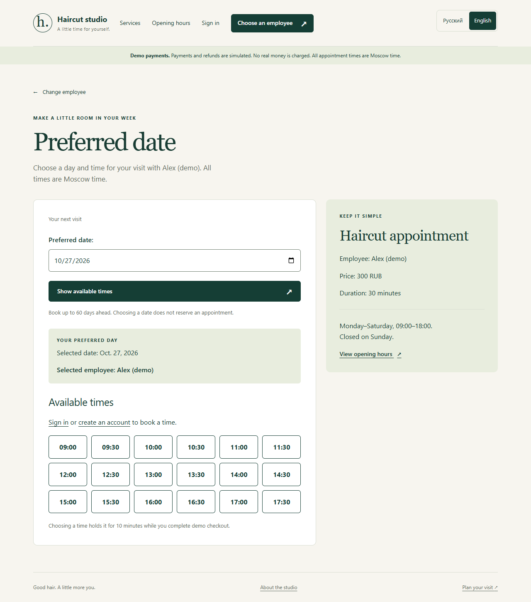
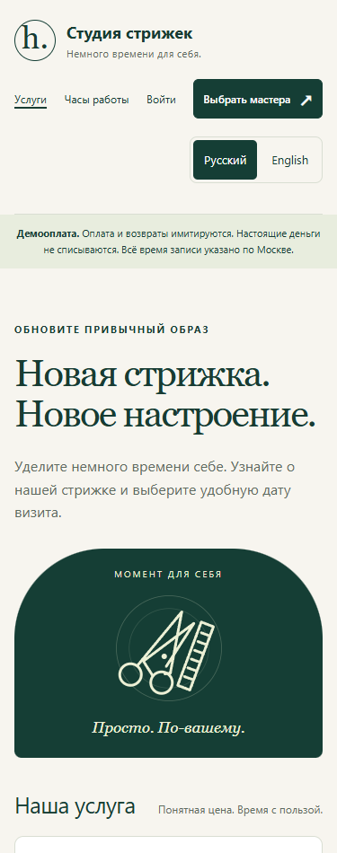

# Haircut Studio — сервис записи в салон

**Русский** · [English](README.en.md)

Веб-приложение на Django и PostgreSQL: выбор мастера и свободного времени,
временный резерв, демонстрационная оплата, личный кабинет и отмена записи.
Основной акцент — согласованность данных при одновременном бронировании,
повторных запросах и истечении резерва.

**Python 3.14 · Django 5.2 · PostgreSQL 18 · Django ORM · HTML/CSS · JavaScript**

[Запуск](docs/SETUP.md) · [Архитектура](docs/ARCHITECTURE.md) ·
[Сценарий демонстрации](docs/PORTFOLIO.md) · [Текст для резюме](docs/RESUME_RU.md)


## Возможности

- **Запись:** доступность конкретного мастера, учёт выходных и отсутствий,
  резерв на 10 минут, история записей, отмена с полным демо-возвратом.
- **Аккаунты:** регистрация, подтверждение email, восстановление пароля;
  двухфакторный вход обязателен для сотрудников и доступен клиентам.
- **Управление студией:** услуги, мастера, интервалы отсутствия, отмены,
  просмотр состояний записей и оплат, экспорт CSV.
- **Русский и английский:** выбор по предпочтениям браузера, переключатель
  с сохранением выбора; время записей всегда московское, цены в рублях.
- **Telegram для сотрудников:** просмотр расписания и записей, сводка,
  очередь уведомлений с повторными попытками и доступом по списку Telegram ID.
  Подключается отдельно; [инструкция](docs/TELEGRAM.md).

## Технические решения

| Задача | Реализация | Где смотреть |
| --- | --- | --- |
| Одновременный выбор одного времени | Транзакция и блокировка строки мастера; повторная проверка пересечений перед сохранением | [Сервис бронирования](booking/services.py), [тесты конкурирующих запросов](booking/test_workflow.py) |
| Повторная отправка формы или результата оплаты | Уникальные ключи запроса и платёжного события, проверки текущего состояния | [Модели](booking/models.py), [сервис](booking/services.py) |
| Изменение цены после записи | Снимок согласованных цены, имён и времени внутри бронирования | [Модель Booking](booking/models.py) |
| Доступ к чужой записи | Выбор записей только владельца, проверка прав на сервере, POST и CSRF для изменений | [Представления](booking/views.py), [проверки безопасности](booking/security.py) |
| Недоступность Telegram | Событие и уведомление сохраняются в одной транзакции; отдельный процесс отправляет очередь | [Telegram](booking/telegram.py), [тесты интеграции](booking/test_telegram.py) |

Пересечения интервалов проверяются в общих функциях бронирования и защищённых
операциях админки. Произвольная запись напрямую в базу может обойти эту проверку;
полная защита пересечений на уровне PostgreSQL не заявляется.

## Проверить за пять минут

1. Открыть каталог и переключить язык.
2. Выбрать мастера и будущий рабочий день, посмотреть свободные интервалы.
3. Зарегистрироваться, подтвердить локальное письмо и создать резерв.
4. Выполнить успешную демо-оплату и открыть подтверждённую запись.
5. Отменить её не менее чем за два часа до визита и проверить полный демо-возврат.

Для локального письма используется команда `manage.py show_email`; письмо
содержит приватную ссылку, которую не нужно публиковать. Отдельная демонстрация
админки и объяснения для собеседования есть в [руководстве](docs/PORTFOLIO.md).

| Доступное время мастера | Русская версия на телефоне |
| --- | --- |
|  |  |

## Локальный запуск

Нужны Python 3.14, PostgreSQL 18, Git и Bash. Для нового клона следуйте
[инструкции настройки](docs/SETUP.md): зависимости закреплены в requirements.txt,
настройки описаны в .env.example, схема базы создаётся миграциями.

После первоначальной настройки, из корня проекта:

```bash
bash scripts/run.sh
```

Скрипт читает приватный .env и использует существующую .venv. Адрес на вашем
компьютере: [http://127.0.0.1:8000/services/](http://127.0.0.1:8000/services/).
Это локальный адрес; публичный сайт пока не размещён.

Демо-данные: стрижка 300 ₽ / 30 минут, два мастера, понедельник–суббота
09:00–18:00, часовой пояс Europe/Moscow. Время можно выбрать на 60 дней вперёд.
Отдельная команда setup_demo создаёт начальные данные, сохраняя существующие.
Пароль владельца генерируется локально и хранится в .local/owner-access.txt;
общего публичного пароля администратора нет.

## Проверки

Из корня проекта с настроенной локальной базой:

```bash
set -a
source .env
set +a
bash scripts/check.sh
```

Команда проверяет предлагаемые Git файлы, перевод, системные настройки Django,
согласованность миграций и выполняет тесты в отдельной PostgreSQL-базе.

В составе проекта **136 автоматических тестов**: бизнес-правила, конкурирующие
бронирования, повторные запросы, границы отмены, права доступа, CSRF, MFA,
локализация и Telegram с подменённым сетевым транспортом. Ранее выполнены
64 проверки страниц в браузере: два языка, восемь страниц, четыре ширины экрана.
Эти проверки браузера выполнялись отдельно и не входят в GitHub workflow.

[GitHub Actions](.github/workflows/checks.yml) запускает проверки с PostgreSQL 18.
Статус первого запуска на GitHub можно подтвердить только после публикации.

## Границы проекта

Это личный учебный проект с разработкой при поддержке ИИ. Реализованы и
проверены локальные сценарии; коммерческая эксплуатация и показатели нагрузки
не заявляются.

- Оплата и возвраты — симуляция, реальные деньги и банковские карты не используются.
- По умолчанию email сохраняется в локальные файлы; внешняя SMTP-доставка не настроена.
- Для Telegram нужны собственный бот, секретный токен и список разрешённых ID.
  Реальная доставка ещё требует настройки и проверки.
- Публичный хостинг, домен и производственная инфраструктура не настроены.
  План подготовки описан в [Deployment](docs/DEPLOYMENT.md).

## Документация

| Документ | Содержание |
| --- | --- |
| [Setup](docs/SETUP.md) | Запуск из нового клона, PostgreSQL, миграции и демо-данные |
| [Architecture](docs/ARCHITECTURE.md) | Схема данных, транзакции, состояния и ограничения |
| [Demo](docs/PORTFOLIO.md) | Короткая демонстрация и технические вопросы |
| [Резюме](docs/RESUME_RU.md) | Готовое описание проекта для отклика |
| [Local development](docs/LOCAL_DEVELOPMENT.md) | Почта, доступ владельца, резервные копии, переводы |
| [Telegram](docs/TELEGRAM.md) | Подключение и команды бота сотрудников |
| [Deployment](docs/DEPLOYMENT.md) | Что требуется перед публичным запуском |

Скриншоты содержат только демонстрационные данные.
