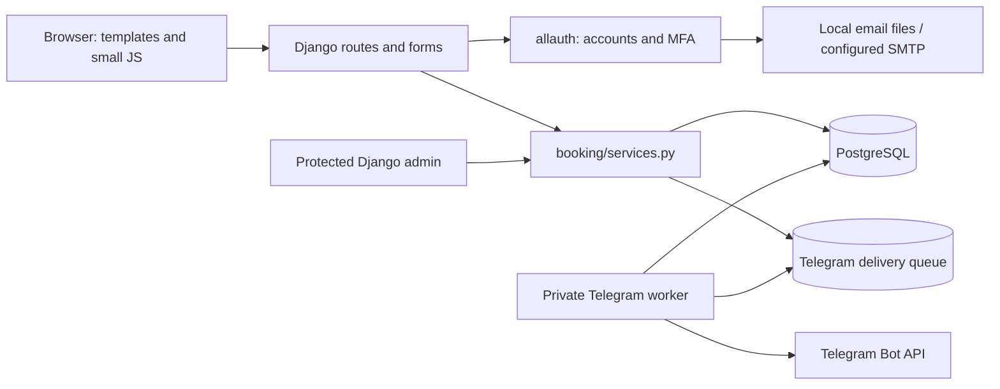
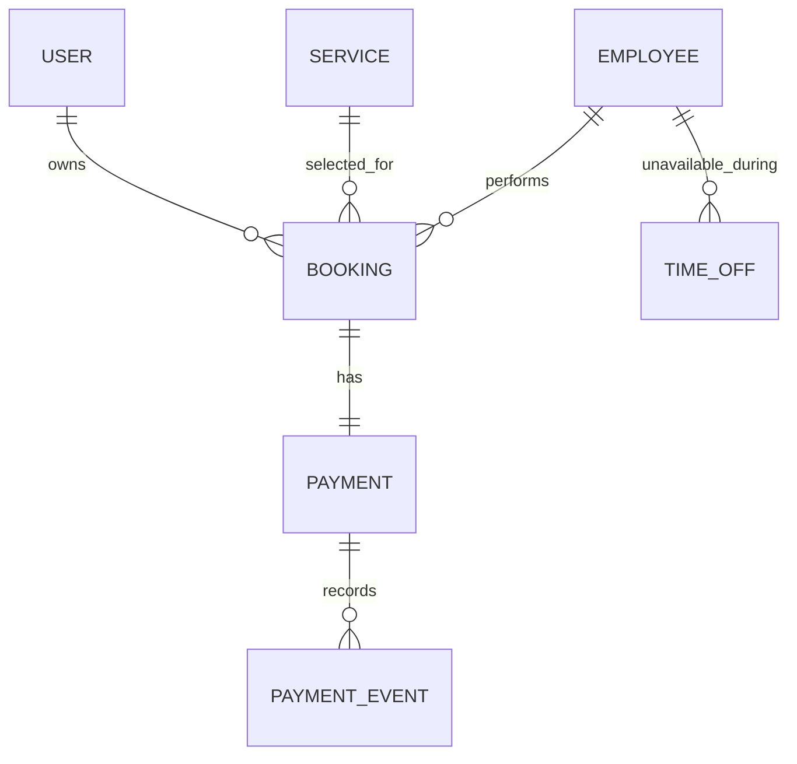
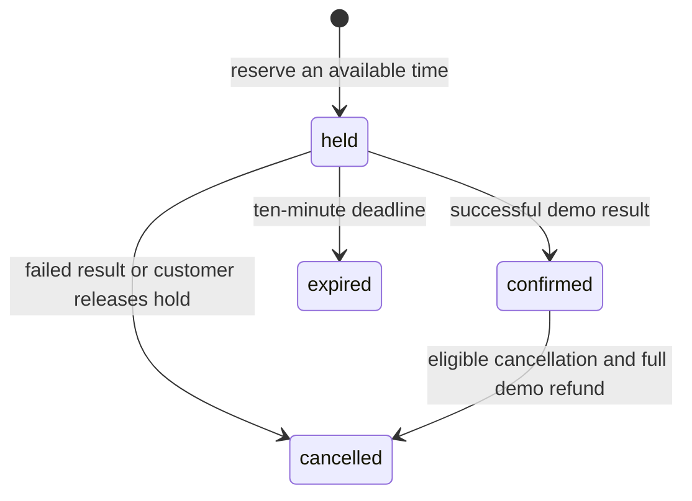

# Architecture and design decisions

Haircut Studio is a small, server-rendered Django application. It deliberately
keeps the customer website, staff tools and shared booking rules in one project.
There is one seeded offer and multiple employees; it is not a general-purpose
multi-tenant scheduling platform.

## Request flow

config/views.py supplies catalog and availability pages. booking/views.py
requires verified accounts for booking operations and scopes records to their
owner. Forms parse input before the shared services recheck business rules.
Templates render the response; JavaScript only updates the visible countdown.
The server decides when holds expire and whether a payment/cancellation succeeds.

## Business data

Supporting cache and throttle tables are omitted from this diagram.
Booking references its customer, service and employee with protected links.
The booking also stores agreed names, price and start/end times, so later catalog
edits do not rewrite an earlier receipt.

Payment is one-to-one with a booking. PaymentEvent has a unique key for a
processed demo result or refund. A booking's unique request key identifies a
submission when the browser retries it.

## Availability and concurrency

A transaction groups related database writes so they succeed or roll back
together. An employee-row lock makes competing supported operations for the same
employee wait their turn.

The reservation sequence is:

1. Begin a transaction and lock the employee.
2. Recognize an existing request key, checking that its customer and details match.
3. Mark that employee's expired unpaid holds.
4. Recalculate availability against confirmed visits, live holds and time off.
5. Save the held booking and its pending demo payment together.

The same lock order—employee, booking, payment—is used for settlement/cancellation.
Database checks require positive prices and valid intervals. A partial unique
constraint additionally rejects equal employee/start pairs in held/confirmed
states.

Different-start interval overlap is an application-level guarantee through the
shared services and protected admin workflow. Direct SQL or arbitrary ORM writes
can bypass it. A database exclusion constraint is a possible future improvement;
the current project does not claim to have one.

## Booking states

Expiry is effective at the deadline even before the stored row is reconciled.
Reads display that effective state. Reservation and the expire_holds command
reconcile old records; a read does not create or confirm a reservation.

Idempotency means a repeated request reuses its existing result. Request keys,
unique payment events and terminal-state handling prevent repeated supported
submissions from producing duplicate bookings, charges or refunds.

The simulator accepts a signed action tied to a payment and event. A signature
detects altered data. It is a local payment demonstration, not evidence that a
real provider collected money.

## Accounts and request boundaries

- allauth handles email verification, recovery and authenticator/recovery codes.
- Staff require verified email and an authenticator before entering admin.
- MFA secrets are encrypted with a key derived from the private Django secret;
  configured fallback keys support deliberate key rotation.
- Booking reads and writes check ownership, and state changes require POST/CSRF.
- Per-identity database-backed limits supplement allauth authentication limits.
- Proxy headers are used only for configured trusted proxy networks.
- Private account/booking responses use no-store; the site supplies security
  headers and a bounded request-body size.

The application-level request limit is not an edge DDoS service. HTTPS, edge
controls, origin restrictions and production monitoring require deployment work.

## Languages

LocaleMiddleware uses an explicit remembered cookie, then the browser's supported
language preferences, then Russian fallback. The interface supports Russian and
English. Existing allauth/Django translations cover account UI and errors; the
project catalog covers its own pages and messages.

Language changes preserve the full current URL, including employee/date choices.
The POST endpoint only accepts supported codes and uses Django's safe redirect
handling. Translated status labels never determine business decisions; stored
state codes do. All appointment times remain Europe/Moscow.

## Verification and reproducibility

The suite uses PostgreSQL, including real competing transactions for equal and
different-start overlapping requests. It also covers retry handling, cutoff
boundaries, ownership, CSRF, MFA, language choice and private setup helpers.

The GitHub workflow prepares the pinned Python dependencies and disposable
PostgreSQL service on a hosted runner. It is saved configuration, not a claim of
a completed hosted run. Local browser checks and fresh-database setup results
are recorded in the development progress notes.

## Deliberate scope

The app offers one service, one salon time zone and a 30-minute start grid.
There is no live payment-provider connection, spreadsheet sync,
multi-location scheduling or public deployment. These can be added around the
shared rules after their external configuration and business requirements are
known.

## Optional Telegram staff integration

booking/telegram.py formats read-only staff replies and handles the HTTP API
using Python's standard library. Private chat and sender IDs must match a
configured numeric allowlist before querying bookings. The bot has no booking
write commands, so it does not expose a new cancellation/refund path around
the site's ownership checks or administrator MFA. This allowlist is a separate
owner-controlled access boundary; protect the allowed Telegram accounts.

Booking services write TelegramDelivery snapshots in the same transaction as
reservations, payment results, cancellations and expiry. A unique constraint
prevents repeating an event for the same booking/bot/recipient. No network call
occurs in booking operations. The optional integration is disabled by default.

run_telegram_bot is a separate foreground process using getUpdates, not a public
webhook. It checks the bot identity, refuses an existing webhook, holds a
PostgreSQL advisory lock to prevent multiple workers for one database and saves
the update offset per bot. It also reconciles expired holds through the shared
service once per minute. Queue row locks prevent parallel processing; bounded
backoff respects Telegram's retry_after. Failed deliveries are inspectable and
retryable through the existing protected Django admin. Revoked recipients are
skipped at send time. Changing to another bot does not reuse old offsets or send
that bot's old queue.

Sending and recording Telegram's response cannot be one database transaction
with Telegram. Ambiguous network failures or crashes after sending can duplicate
a notification or read-only command reply; exactly-once delivery is not claimed.
Snapshots contain customer data, so database access/backup controls and an
explicit retention policy matter. No retention cleanup is scheduled yet.
Tests use a fake HTTP service and real PostgreSQL; live Telegram delivery needs
a separately configured token, allowlist, user-started chat and running worker.
See [Telegram](TELEGRAM.md) for setup and remaining feature ideas.
