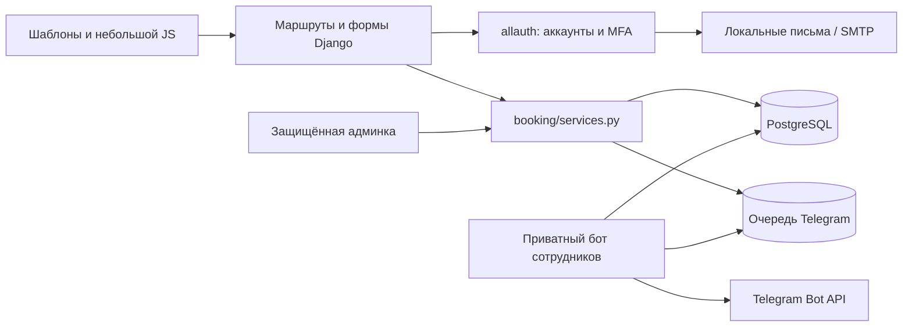
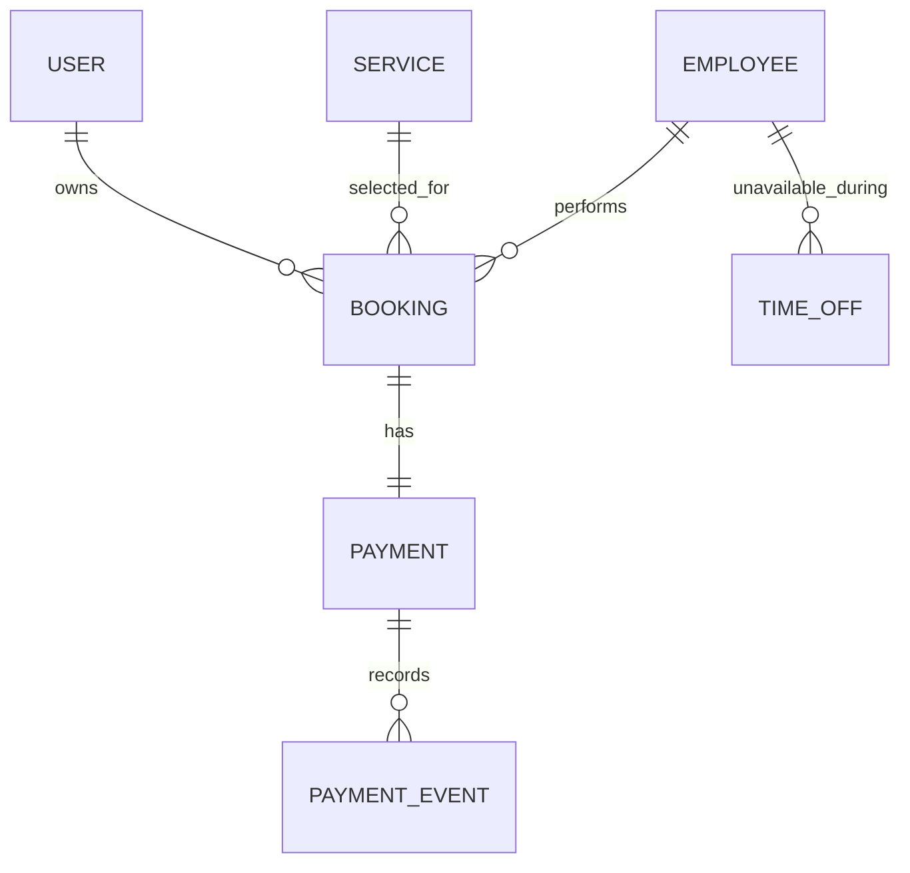
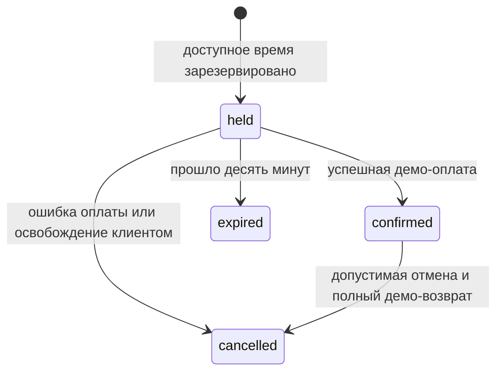

# Архитектура и технические решения

**Русский** · [English](ARCHITECTURE.md)

Небольшое серверное Django-приложение объединяет клиентский сайт, инструменты
сотрудников и общие правила записи. Один начальный вид услуги, несколько мастеров;
это не многопользовательская платформа расписаний разных организаций.

`config/views.py` отвечает за каталог и доступность; `booking/views.py` требует
подтверждённый аккаунт и выбирает записи владельца. Формы разбирают ввод,
сервисы повторно проверяют правила. JavaScript показывает отсчёт времени;
срок, оплату и отмену определяет сервер.

## Данные

Связи записи с клиентом, услугой и мастером защищены. Согласованные имена,
цена и интервал сохраняются снимком, поэтому последующее изменение каталога
не меняет квитанцию. Payment соответствует одному Booking; уникальный ключ
PaymentEvent отмечает обработанный результат/возврат. Отдельный ключ запроса
распознаёт повтор формы. Таблицы cache/throttle на диаграмме опущены.

## Доступность и конкуренция

Операция резервирования:

1. Начать транзакцию и заблокировать строку мастера.
2. Проверить существующий ключ запроса, совпадение клиента и параметров.
3. Отметить истёкшие неоплаченные резервы этого мастера.
4. Пересчитать пересечения с подтверждёнными визитами, резервами и отсутствиями.
5. Вместе сохранить резерв и ожидающую демо-оплату.

Расчёт/отмена используют тот же порядок блокировок: мастер, запись, оплата.
Ограничения БД требуют положительной цены и верного интервала. Частичная
уникальность дополнительно защищает одинаковое начало у held/confirmed.

Пересечения с разным началом защищены общими сервисами и админкой. Прямой SQL
или произвольная ORM-запись может обойти проверку; PostgreSQL exclusion constraint
в этой версии нет.

## Состояния

Срок действует с дедлайна, даже пока строка ещё не обновлена. Чтение показывает
эффективное состояние, но не создаёт и не подтверждает запись. Новая бронь
и `expire_holds` согласуют старые резервы.

Уникальные запросы/события и конечные состояния делают поддержанные повторы
безопасными. Симулятор проверяет подписанное действие конкретной оплаты;
подпись не доказывает получение реальных денег.

## Аккаунты и границы запроса

- allauth: email, восстановление, аутентификатор и recovery codes.
- Сотрудникам обязательны подтверждённый email и аутентификатор.
- Секреты MFA зашифрованы ключом от приватного Django secret; поддерживаются fallback keys.
- Владелец проверяется при чтении/изменении; изменения требуют POST/CSRF.
- Лимиты по идентификатору хранятся в БД и дополняют ограничения allauth.
- Proxy-заголовки принимаются только от настроенных доверенных сетей.
- Приватные ответы используют no-store; установлены заголовки и предел размера тела.

Прикладной лимит не заменяет edge DDoS-защиту. HTTPS, ограничения origin
и мониторинг требуют отдельного размещения.

## Языки

LocaleMiddleware использует явный cookie, предпочтения браузера и русский fallback.
Django/allauth переводят аккаунты; каталог проекта — собственные страницы и ошибки.
Переключение сохраняет URL, мастера и дату. POST принимает только поддержанные коды
с безопасным redirect. Переведённые подписи не управляют бизнес-решениями;
в базе сохраняются коды состояний. Время всегда Europe/Moscow.

## Проверки и границы

PostgreSQL-тесты включают конкурентные одинаковые и пересекающиеся интервалы,
повторы, срок отмены, владельца, CSRF, MFA, язык и приватные setup-команды.
Наличие workflow само по себе не доказывает успешный hosted run; результаты
локальных проверок и CI следует различать.

Одна студия, один часовой пояс, сетка начала 30 минут. Публичного хостинга,
реального эквайринга, синхронизации таблиц и нескольких филиалов нет.

## Дополнительный Telegram

`booking/telegram.py` использует стандартную библиотеку. До чтения записей
проверяются личный чат и числовой allowlist. Команд изменения брони/оплаты нет;
эта граница доступа не заменяет MFA админки.

TelegramDelivery создаётся в транзакции бронирования; сеть вынесена в отдельный
`run_telegram_bot`. Уникальность защищает событие/запись/бота/получателя.
Worker использует getUpdates, отказывается работать с активным webhook,
держит advisory lock, сохраняет offset и раз в минуту согласует просроченные
резервы. Повторы ограничены, учитывают retry_after; ошибки видны в защищённой
админке, отозванные получатели пропускаются, очередь разных ботов не смешивается.

Отправку Telegram и фиксацию ответа нельзя объединить одной транзакцией.
Неоднозначный сетевой сбой может дать повтор уведомления или безопасного ответа;
exactly-once не обещается. История содержит клиентские сведения; автоматическая
очистка пока не настроена. Тесты используют fake HTTP и PostgreSQL.
[Подключение и команды](TELEGRAM.md).
