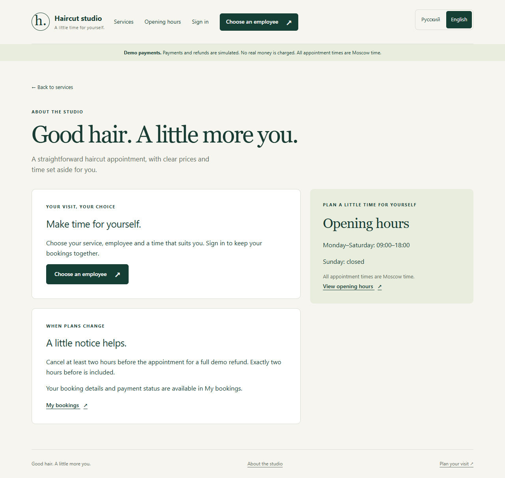

# Portfolio presentation and demo

## Short project description

Haircut Studio is a bilingual appointment-booking application built with Django
and PostgreSQL. Customers choose an employee and available time, create a
temporary hold, complete simulated checkout and manage eligible cancellations.
The project demonstrates transactional booking rules, retry-safe payment/refund
handling, protected accounts and responsive server-rendered pages.

Development context: a guided learning project with AI-assisted implementation.
Describe the features and tests you can explain; avoid claiming production
customers, real payment processing or independent expertise that has not been
demonstrated.

## A five-minute walkthrough

Prepare the app using [Setup](SETUP.md). Start it with bash scripts/run.sh and
keep the private owner file and email messages out of the screen recording.

| Step | Show | Explain |
| --- | --- | --- |
| 1 | Catalog at desktop and phone widths | Django templates, responsive layout, clear price/duration |
| 2 | Русский / English switch | Browser preference, remembered override, Moscow times |
| 3 | Choose employee, then a future working day | Availability is specific to the employee |
| 4 | Register and verify email locally | Actual account gates; file email is a development substitute |
| 5 | Select a time and open demo checkout | Ten-minute hold; server enforces expiry |
| 6 | Simulate success and inspect the receipt | Confirmation follows server-side processing |
| 7 | Cancel an eligible visit and inspect the refund | At least two hours' notice; one full simulated refund |
| 8 | Open the repository's architecture guide | Explain design decisions and the demo's scope |

Use a date more than two hours in the future. Sunday is closed. To demonstrate
failure, use a separate new hold and click the failure button; the time should
become available again. Do not use a real customer's records for a demonstration.

Account verification links are private. Read local mail in a private terminal,
then show the confirmed account page rather than the full message/token.
No real money or card data is involved.

## Optional staff walkthrough

Use the locally generated owner credentials. Complete authenticator setup and
save recovery codes privately before recording.

Show employee activation, a time-off block, read-only booking/payment records,
the cancellation action and CSV export. Availability should remove times covered
by time off. Adding time off over a live appointment is rejected until the
appointment is moved or cancelled.

Keep owner passwords, QR seeds, recovery codes, browser sessions and customer
email addresses out of public screenshots.

## Explain three engineering choices

**Why PostgreSQL?** The application depends on database transactions and row
locks. Using the same database family for development and tests makes the
concurrency checks meaningful.

**How do two simultaneous customers avoid taking the same time?** Both supported
reservation paths lock the same employee row. After waiting, the second request
rechecks availability and sees the first reservation.

**What happens if a browser sends the payment twice?** A unique event key and the
payment/booking state make processing repeat-safe. The refund path also uses a
unique event and does not refund a cancelled booking again.

Point to booking/services.py and the concurrency/workflow tests. Be explicit that
direct SQL writes can bypass the application-level interval-overlap check.

## Suggested portfolio card

**Title:** Haircut Studio — Django booking application

**Description:** Bilingual salon booking with employee availability, temporary
holds, simulated checkout/refunds, email-verified accounts and staff MFA.
PostgreSQL tests exercise booking conflicts and repeated payment requests.

**Technology tags:** Python, Django, PostgreSQL, HTML/CSS, JavaScript, testing.

Use the repository URL once it exists. Add a public demo URL only after actual
hosting and delivery configuration have been verified. The local 127.0.0.1 link
works only on the computer running the application.

## Evidence included in this repository

- Current public-facing screenshots under docs/screenshots.
- Business rules and state flow in [Architecture](ARCHITECTURE.md).
- A reproducible [setup guide](SETUP.md) and pinned dependencies.
- PostgreSQL tests, private-file review and saved GitHub check configuration.
- Explicit [deployment boundaries](DEPLOYMENT.md), with no fake status badge.

