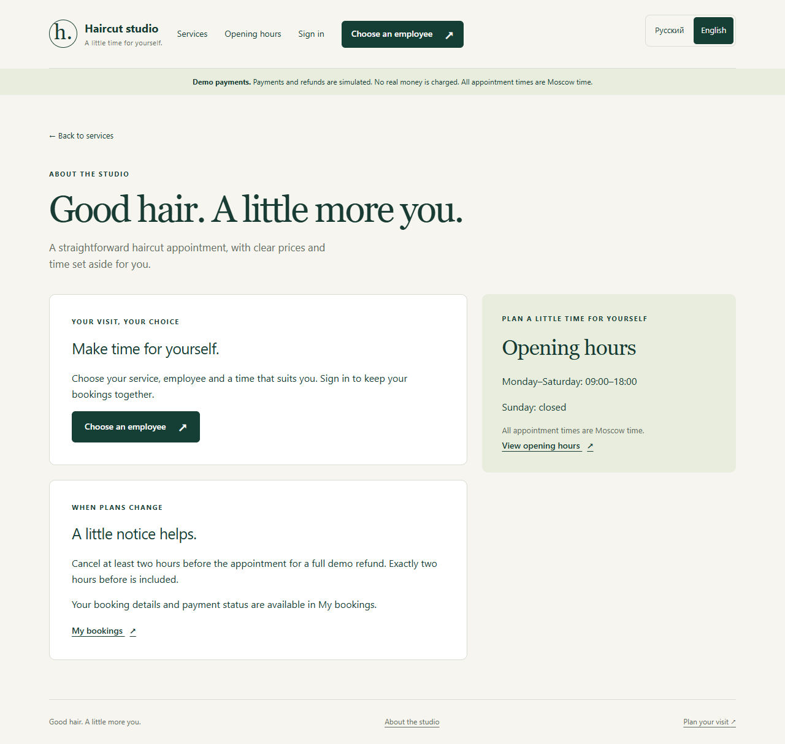

# Демонстрация и представление проекта

**Русский** · [English](PORTFOLIO.md)

Haircut Studio — Django/PostgreSQL-приложение записи с двумя языками, выбором
мастера и времени, резервом, демо-оплатой и допустимой отменой. Технический
акцент: транзакции, повторы запросов, защищённые аккаунты и адаптивные шаблоны.
Учебный проект разработан при поддержке ИИ; показывайте функции и тесты,
которые можете объяснить, без вымышленных клиентов и промышленной эксплуатации.

## Пять минут

Подготовьте [окружение](SETUP.ru.md), выполните `bash scripts/run.sh`.
Скройте файл владельца, письма, токены и аутентификатор из записи экрана.

| Шаг | Показать | Объяснить |
| --- | --- | --- |
| 1 | Каталог на компьютере и телефоне | Шаблоны, адаптивность, цена/длительность |
| 2 | Русский / English | Предпочтение браузера, сохранение выбора, московское время |
| 3 | Мастер и будущий рабочий день | Расписание конкретного мастера |
| 4 | Регистрация и локальное подтверждение email | Проверка аккаунта; файлы заменяют SMTP в разработке |
| 5 | Время и демо-оплата | Десятиминутный резерв, срок контролирует сервер |
| 6 | Успех и квитанция | Подтверждение после серверной обработки |
| 7 | Допустимая отмена | Не менее двух часов до визита, один полный демо-возврат |
| 8 | Архитектура и тесты | Решения и ограничения |

Выберите дату более чем через два часа, не воскресенье. Для отказа оплаты
создайте другой резерв: время должно снова освободиться. Не используйте реальные
клиентские записи. Ссылку письма прочитайте приватно, затем покажите готовый аккаунт.

## Админка

Войдите по локальным данным, заранее настройте аутентификатор и сохраните recovery
codes приватно. Покажите активность мастера, отсутствие, записи/оплаты только
для чтения, отмену и CSV. Отсутствие поверх активного визита должно отклоняться.
Не публикуйте пароль, QR seed, recovery codes, сессии и email клиентов.

## Три решения для обсуждения

**PostgreSQL:** настоящие транзакции и row locks; одинаковая семья БД в разработке и тестах.

**Два клиента на одно время:** оба запроса блокируют строку мастера; второй
после ожидания повторно проверяет доступность и видит первый резерв.

**Повтор оплаты:** уникальный event key и текущее состояние исключают повтор
эффекта. Возврат также имеет уникальное событие. Покажите `booking/services.py`
и workflow/concurrency-тесты. Прямой SQL способен обойти проверку пересечений интервалов.

## Карточка проекта

**Haircut Studio — онлайн-запись на Django.** Русский/английский, доступность
мастеров, временный резерв, тестовые оплата/возврат, email и MFA сотрудников.
PostgreSQL-тесты проверяют конфликты бронирования и повторные платежные запросы.

Теги: Python, Django, PostgreSQL, HTML/CSS, JavaScript, testing.
[Исходники](https://github.com/Sasambatra/django-salon-booking) · [Текст для резюме](RESUME_RU.md).
Публичную demo-ссылку добавляют после реального размещения; 127.0.0.1 работает
только на компьютере с сервером.

## Свидетельства

Скриншоты в docs/screenshots, [архитектура](ARCHITECTURE.ru.md),
[установка](SETUP.ru.md), закреплённые зависимости, PostgreSQL-тесты,
проверка публикуемых файлов и workflow. [Границы размещения](DEPLOYMENT.ru.md).

